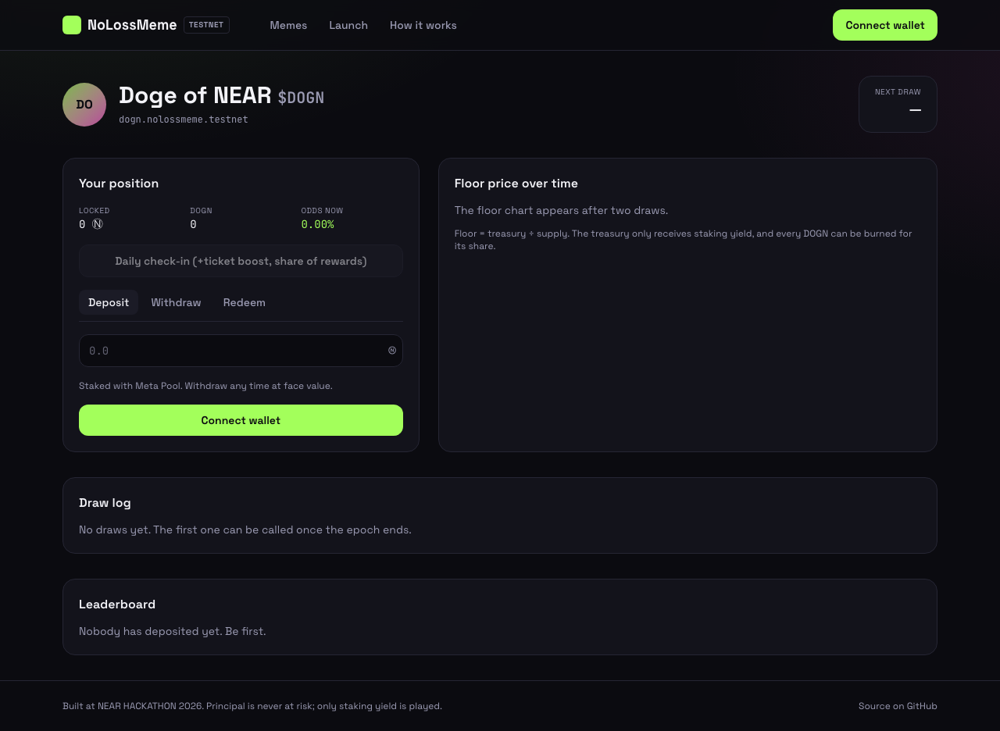
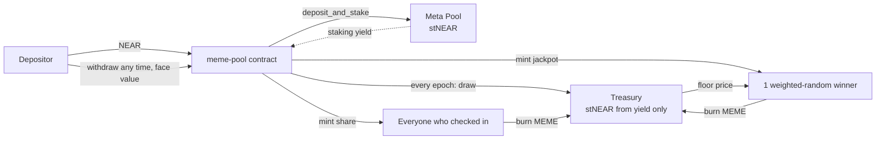
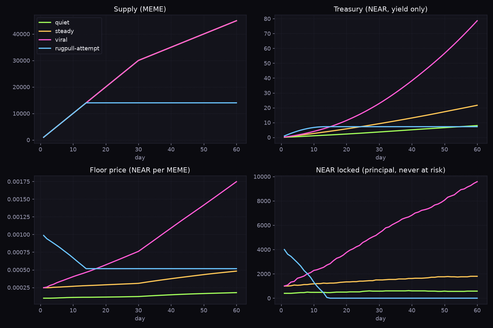

# NoLossMeme

**Memecoins you can't lose on.** Deposit NEAR, keep every yocto, and let only the staking
yield be turned into meme tokens and raffled off. Every token can be burned for its share of
the treasury, so the floor can never reach zero.

Built at [NEAR HACKATHON](https://nearhackathon.com) (Nov 2026). Tracks: **Memecoins With
Mechanics** (primary), Unstoppable DeFi, Social Money, Open Innovation.

[](https://github.com/nolossmeme/nolossmeme/actions/workflows/contracts.yml)
[](https://github.com/nolossmeme/nolossmeme/actions/workflows/web.yml)
[](https://github.com/nolossmeme/nolossmeme/actions/workflows/sim.yml)

|                 |                                                                                                                                                                                                                |
| --------------- | -------------------------------------------------------------------------------------------------------------------------------------------------------------------------------------------------------------- |
| Live on testnet | factory [`nolossmeme.testnet`](https://testnet.nearblocks.io/address/nolossmeme.testnet), first pool [`dogn.nolossmeme.testnet`](https://testnet.nearblocks.io/address/dogn.nolossmeme.testnet) (hourly draws) |
| Staking         | Meta Pool testnet [`meta-v2.pool.testnet`](https://testnet.nearblocks.io/address/meta-v2.pool.testnet) (stNEAR)                                                                                                |
| Keeper          | [`keeper.nolossmeme.testnet`](https://testnet.nearblocks.io/address/keeper.nolossmeme.testnet), GitHub Actions cron every 15 min                                                                               |
| Web app         | **<https://nolossmeme.github.io/nolossmeme/>** (GitHub Pages, auto-deployed from `main`), or `pnpm --filter @nolossmeme/web dev` (step 5 below)                                                                |
| Demo post       | _added at submission_                                                                                                                                                                                          |

<p align="center"></p>

## The mechanic in one minute



1. **Deposit** NEAR. The pool stakes it with Meta Pool. Your principal is recorded at face value and is withdrawable at any time as stNEAR (no fee) or as NEAR (Meta Pool liquid unstake).
2. **Tickets** accrue as NEAR-seconds: a deposit made just before a draw earns almost nothing. A once-per-epoch **check-in** builds a streak that multiplies your weight (capped).
3. **Draw** (permissionless, once the epoch ends): the staking yield since the last draw is swept into the treasury; a fixed, halving emission of MEME is minted. `jackpot_bps` of it goes to one weighted-random depositor, the rest is split equally among everyone who checked in. No check-ins, no community mint.
4. **Floor**: `floor = treasury / supply`. Burn MEME any time (`redeem`) for that share, paid in stNEAR. The treasury only ever receives yield, so the floor never reaches zero and a "rug" is impossible: if everyone leaves, every depositor has their NEAR back and every holder still has a backed token.
5. **No admin.** All parameters are fixed in `new` and public via `get_params`. There is no owner, no upgrade key, no pause.

<p align="center"></p>

60-day simulation (`tools/sim`): in the `rugpull-attempt` scenario everyone exits by day 14; NEAR locked drops to zero while treasury and floor hold.

## For judges: do X, see Y

Prerequisites: Rust (the `contracts/rust-toolchain.toml` pins 1.96), [`cargo-near`](https://github.com/near/cargo-near), Node 22 + pnpm 10, [`uv`](https://docs.astral.sh/uv/) for the simulator. Everything else is installed by the commands below.

1. `git clone https://github.com/nolossmeme/nolossmeme && cd nolossmeme && pnpm install`
   → see pnpm install the workspace and Husky register the git hooks.
2. `cd contracts && cargo test --workspace --lib`
   → see **30 unit tests pass** (26 for `meme-pool`: vault accounting, ticket weights, streak cap, draw settlement, halving, redeem and rollback paths; 4 for `factory`).
3. `cargo test -p integration-tests`
   → see **4 sandbox tests pass** after the wasm is built and a local `near-sandbox` starts: a full epoch lifecycle (deposit → check-in → 2 % yield → draw → redeem → withdraw as stNEAR → withdraw as NEAR), a rejected over-withdraw, the absence of admin methods, and a factory launch. Takes 1–3 minutes on the first run.
4. `cd .. && pnpm --filter @nolossmeme/sdk test`
   → see **15 tests pass** for the TypeScript SDK (formatting, transaction builders, tokenomics mirrors, RPC client).
5. `pnpm --filter @nolossmeme/sdk build && pnpm --filter @nolossmeme/web dev`, open <http://localhost:5173>
   → see the **Doge of NEAR** pool with live testnet data: NEAR locked, floor, next-draw countdown, draw log. Connect a testnet wallet (HOT, Meteor, MyNearWallet) to deposit 0.1 Ⓝ, check in, and withdraw again.
6. `DRY_RUN=1 pnpm --filter @nolossmeme/keeper start`
   → see the keeper list every pool and print `skip (epoch ends in Ns)` or `would draw epoch #N`.
7. `cd tools/sim && uv run --with matplotlib --with pytest python -m pytest -q && uv run --with matplotlib python -m nolossmeme_sim.cli --out output`
   → see **4 tests pass** and `output/projection.png` regenerated with the table printed above it.
8. Read the chain directly (no tooling needed):
   ```bash
   curl -s https://test.rpc.fastnear.com -H 'content-type: application/json' -d '{"jsonrpc":"2.0","id":1,"method":"query","params":{"request_type":"call_function","finality":"final","account_id":"dogn.nolossmeme.testnet","method_name":"get_state","args_base64":"e30="}}' | python3 -c 'import sys,json;print(bytes(json.load(sys.stdin)["result"]["result"]).decode())'
   ```
   → see the pool state JSON (`total_principal`, `treasury_shares`, `floor_price`, `next_draw_at`, …).

## Repository layout

| Path                                                         | What                                                                                             | Stack                                        |
| ------------------------------------------------------------ | ------------------------------------------------------------------------------------------------ | -------------------------------------------- |
| [`contracts/meme-pool`](contracts/meme-pool)                 | One contract per memecoin: vault, tickets, draw, redeem, NEP-141/145/148                         | Rust, near-sdk 5.30, near-contract-standards |
| [`contracts/factory`](contracts/factory)                     | Launches `<slug>.<factory>`, stores the pool wasm once (frozen, hash public), keeps the registry | Rust                                         |
| [`contracts/mock-metapool`](contracts/mock-metapool)         | Meta Pool stand-in with a settable price for sandbox tests                                       | Rust                                         |
| [`contracts/integration-tests`](contracts/integration-tests) | near-sandbox end-to-end tests                                                                    | near-sandbox 0.4, near-api-rs                |
| [`packages/sdk`](packages/sdk)                               | Typed RPC client, wallet-agnostic transaction builders, contract math mirrors                    | TypeScript, near-api-js 7                    |
| [`apps/web`](apps/web)                                       | Memes list, pool page, launch form with 60-day projection, how-it-works                          | Vite, React 19, Tailwind 4, near-connect     |
| [`tools/keeper`](tools/keeper)                               | Calls `draw` where due; cron in `.github/workflows/keeper.yml`                                   | TypeScript                                   |
| [`tools/sim`](tools/sim)                                     | Tokenomics simulation and charts                                                                 | Python                                       |

### `meme-pool` module map

| Module       | Responsibility                                                                                                      |
| ------------ | ------------------------------------------------------------------------------------------------------------------- |
| `vault.rs`   | `deposit`, `withdraw` (stNEAR), `withdraw_near` (liquid unstake); state committed in callbacks, restored on failure |
| `tickets.rs` | `check_in`, streak bonus, NEAR-second weights                                                                       |
| `draw.rs`    | `draw` → `on_draw_price`: sweep yield, settle tickets, pick winner, mint, roll epoch                                |
| `redeem.rs`  | burn MEME for pro-rata treasury stNEAR                                                                              |
| `token.rs`   | NEP-141 core, NEP-145 storage (flat 0.005 Ⓝ, refundable), NEP-148 metadata                                          |
| `views.rs`   | `get_state`, `get_account`, `get_draws`, `get_depositors`, `get_params`                                             |
| `math.rs`    | U256-backed `mul_div`, share/price conversion, emission schedule, floor                                             |

### Pool parameters (fixed at launch)

| Parameter                                  | Meaning                                           | DOGN on testnet |
| ------------------------------------------ | ------------------------------------------------- | --------------- |
| `epoch_length_ns`                          | time between draws                                | 1 h             |
| `initial_emission`                         | MEME minted per epoch at launch                   | 1 000           |
| `halving_every`                            | emission halves every N epochs                    | 168 (weekly)    |
| `jackpot_bps`                              | share of emission to the single winner            | 70 %            |
| `streak_step_bps` / `max_streak_bonus_bps` | ticket boost per consecutive check-in and its cap | +10 % / 50 %    |
| `min_deposit`                              | smallest deposit                                  | 0.1 Ⓝ           |

## Launch your own

Through the web app (**Launch** page) or with the CLI:

```bash
near contract call-function as-transaction nolossmeme.testnet create_meme \
  json-args '{"slug":"pepn","name":"Pepe of NEAR","symbol":"PEPN","icon":"🐸","params":{"epoch_length_ns":"86400000000000","initial_emission":"1000000000000000000000","halving_every":30,"jackpot_bps":7000,"streak_step_bps":1000,"max_streak_bonus_bps":5000,"min_deposit":"100000000000000000000000"}}' \
  prepaid-gas '300 Tgas' attached-deposit '3.5 NEAR' sign-as you.testnet network-config testnet sign-with-keychain send
```

The attached NEAR funds the new account's storage (`get_launch_cost`, ≈ 3.2 Ⓝ). To deploy a fresh factory: `contracts/scripts/deploy-testnet.sh <account.testnet>`.

## Known limits

- **Randomness.** The draw hashes `env::random_seed()` with the epoch index and total weight. The producer of the block containing the `on_draw_price` receipt can predict it. Fine for a hackathon; a commit-reveal from the keeper or a VRF is the upgrade path.
- **Draw cost is O(depositors).** One callback settles every depositor (270 TGas). Hundreds of accounts are fine; thousands need paged settlement or a sum tree.
- **Sybil resistance of check-ins** is the deposit itself: a check-in only boosts weight you already have (`min_deposit` applies), and the community share is split per account, so splitting a deposit across accounts does not increase the expected jackpot and only redistributes the community share. A per-account minimum weight for the community share would tighten this.
- **Meta Pool minimum.** `meta-v2.pool.testnet` rejects stakes under 1 Ⓝ; a smaller deposit is refunded by the pool's callback (no loss, but no deposit). Set `min_deposit` ≥ 1 Ⓝ at launch; the web app enforces it.
- **`withdraw_near`** depends on Meta Pool's liquidity pool and pays its swap fee; `withdraw` (stNEAR) always works and is free.
- **Slashing** of the staking pool would leave the last withdrawers short; the treasury is never used to cover principal.
- **No upgrades.** A pool cannot be patched; a new one would have to be launched.

## Development

```bash
pnpm install                 # workspace + git hooks (commitlint, lint-staged)
pnpm contracts:lint          # cargo fmt --check + clippy -D warnings
pnpm contracts:test          # all Rust tests
pnpm lint && pnpm test       # TypeScript packages
pnpm --filter @nolossmeme/web build
```

CI: `contracts` (fmt, clippy, unit, sandbox), `web` (format, lint, test, build), `sim` (pytest + chart), `sonar` (SonarQube Cloud), `keeper` (cron). See [CONTRIBUTING.md](CONTRIBUTING.md) for the branch and commit conventions.

## Hackathon notes

- All code was written during the hackathon window (first commit 4 Nov 2026). Tags: `pre-hackathon` (empty repository), `hackathon-submission` (the submitted state).
- Libraries and templates: `near-sdk` / `near-contract-standards` 5.30, `cargo-near` project template, `near-sandbox`, `near-api-rs`, `near-api-js` 7, `near-connect-hooks`, `@tanstack/react-query`, `recharts`, Tailwind 4, matplotlib. Meta Pool is integrated through its public contract interface. AI coding assistants were used, as the rules allow.
- Testnet only. Nothing here is audited; do not deploy to mainnet with real funds without an audit.

## License

[MIT](LICENSE)
